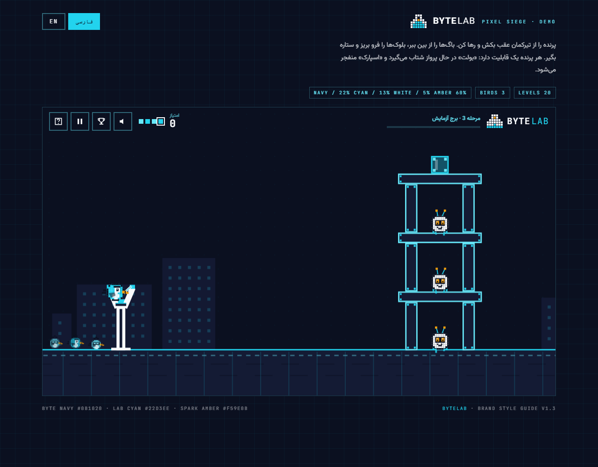

# BYTELAB · Pixel Siege

**بازی «کشیدن و شلیک» فیزیکی برای وردپرس، ساخته‌شده با سیستم برند «فلاسک پیکسلی» بایت‌لب.**

[English](README.md) · [دمو](demo/bytelab-pixel-siege-demo.html) · [تصاویر](screenshots/)

پرندهٔ پیکسلی را عقب بکش، رها کن و برج‌های Panel Navy را فرو بریز. بیست مرحله، سه نوع پرنده، ستاره، جدول امتیازات و ویرایشگر JSON مرحله — همه در یک افزونهٔ وردپرس که فونت‌هایش را همراه دارد و **هیچ وابستگی خارجی** ندارد.



## ویژگی‌ها

| | |
| --- | --- |
| **فیزیک واقعی** | اجسام صلب چرخان، برخورد SAT، حل‌کنندهٔ impulse با warm starting، خواب اجسام و گام ثابت ۱۲۰ هرتز. بدون Box2D، بدون jQuery، بدون CDN. |
| **۲۰ مرحله** | از یک کلبه تا دژ سه‌طبقه و فلاسکی از ۲۳ بلوک. همه با ربات حل‌کننده تست شده‌اند که قابل پاک‌شدن باشند. |
| **۴ متریال** | پنل، دیوار، شیشه و فولاد — هر کدام با جرم، سختی و رفتار شکست خودشان. |
| **۳ پرنده** | **بایت** (متعادل)، **بولت** (شتاب در پرواز)، **اسپارک** (انفجار). |
| **صفحهٔ آماده‌باش** | ابتدای هر مرحله پرنده‌های همان مرحله و قابلیتشان نمایش داده می‌شود. |
| **صف پرنده‌ها** | بقیهٔ پرنده‌ها پشت تیرکمان صف می‌کشند و بعد از هر شلیک، پرندهٔ بعدی روی کمان می‌پرد. |
| **جدول امتیازات** | ۱۰ رکورد برتر هر مرحله از REST، با مشخص‌شدن ردیف خودِ کاربر. |
| **مرحلهٔ سفارشی** | JSON را در تنظیمات بچسبان؛ سمت سرور اعتبارسنجی و محدود می‌شود. |
| **فونت برند** | وزیرمتن + JetBrains Mono به‌صورت لوکال (SIL OFL 1.1). |
| **دسترس‌پذیر** | کنترل کامل با کیبورد، `aria-live`، احترام به `prefers-reduced-motion`. |
| **دوزبانه** | فارسی (RTL) و انگلیسی (LTR) بر اساس زبان وردپرس. |

## نصب

۱. پیشخوان → **افزونه‌ها → افزودن → بارگذاری افزونه** → `bytelab-pixel-siege.zip` → نصب → فعال‌سازی.
۲. در برگه یا نوشته:

```
[bytelab_pixel_siege level="1" height="640"]
```

یا در ویرایشگر بلوک `/pixel-siege` را تایپ کنید.

| ویژگی شورت‌کد | پیش‌فرض | توضیح |
| --- | --- | --- |
| `level` | ۱ | مرحلهٔ شروع (۱ تا ۲۰ یا شمارهٔ مرحلهٔ سفارشی) |
| `height` | ۶۴۰ | بیشترین ارتفاع به پیکسل (نسبت ۱۶:۹ حفظ می‌شود) |
| `sound` | `1` | `0` برای شروع بی‌صدا |
| `title` | — | عنوان دلخواه |

تنظیمات: **تنظیمات → BYTELAB Pixel Siege** (مرحلهٔ پیش‌فرض، ارتفاع، صدا، امتیاز مهمان، جدول امتیازات، صفحهٔ آماده‌باش، متن‌های دلخواه و مراحل سفارشی).

## طرز بازی

- پرنده را از تیرکمان عقب بکش و رها کن؛ کمانهٔ نقطه‌چین مسیر را نشان می‌دهد.
- در حال پرواز ضربه بزن (یا `Space`) تا قابلیت پرنده فعال شود.
- همهٔ باگ‌ها را پاک کن تا مرحله تمام شود.
- **کیبورد:** جهت‌ها نشانه‌گیری، `Space`/`Enter` شلیک، `P`/`Esc` توقف، `R` شروع دوباره.

| پرنده | رنگ | قابلیت |
| --- | --- | --- |
| بایت | Lab Cyan | متعادل، بدون قابلیت ویژه |
| بولت | Liquid Cyan | شتاب در پرواز |
| اسپارک | Spark Amber | انفجار با ضربه |

## ساخت مرحله (JSON)

در **تنظیمات → Custom levels (JSON)** یک آرایه از مراحل بگذار:

```json
[
  {
    "name": { "fa": "آزمایش من", "en": "My Test" },
    "birds": ["byte", "spark", "bolt"],
    "blocks": [
      { "x": 900, "baseY": 570, "w": 30, "h": 120, "m": "panel" },
      { "x": 1000, "baseY": 570, "w": 30, "h": 120, "m": "panel" },
      { "x": 950, "baseY": 450, "w": 160, "h": 24, "m": "wall" }
    ],
    "bugs": [{ "x": 950, "surfaceY": 426, "r": 20 }]
  }
]
```

| کلید | معنی |
| --- | --- |
| `blocks[].x` | مرکز افقی (۰ تا ۱۲۸۰) |
| `blocks[].baseY` | سطحی که بلوک روی آن می‌ایستد (پایین بلوک) |
| `blocks[].y` | جایگزین: مرکز عمودی |
| `blocks[].w` / `h` | ۸ تا ۴۰۰ |
| `blocks[].m` | `panel` · `wall` · `glass` · `deep` · `steel` |
| `bugs[].surfaceY` / `y` | سطح نشستن باگ یا مرکز آن |
| `bugs[].r` | ۸ تا ۴۰ |
| `birds` | `byte` · `bolt` · `spark` |

زمین در `y = 570` است؛ پس `"baseY": 570` یعنی روی زمین. محدودیت‌ها: ۴۰ مرحله، ۹۰ بلوک، ۱۲ باگ، ۱۰ پرنده. JSON خراب ذخیره نمی‌شود، مقادیر خارج از بازه اصلاح می‌شوند و متریال/پرندهٔ ناشناس به پیش‌فرض برمی‌گردد.

## جدول امتیازات

`GET /wp-json/bytelab-pixel-siege/v1/leaderboard?level=3` ده رکورد برتر را برمی‌گرداند و `POST /wp-json/bytelab-pixel-siege/v1/score` با `{ "level": 3, "score": 4820, "stars": 3 }` امتیاز را ذخیره می‌کند. محدودیت نرخ ۶۰ ارسال در ساعت و نوشتن با prepared statement.

## برند

| توکن | کد | کاربرد |
| --- | --- | --- |
| Byte Navy | `#0B1020` | پس‌زمینهٔ اصلی |
| Panel Navy | `#141B34` | بلوک‌ها و پنل‌ها |
| Lab Cyan | `#22D3EE` | رنگ اصلی |
| Liquid Cyan | `#67E8F9` | لبه‌ها و تأکید |
| Deep Cyan | `#0891B2` | لهجهٔ گرافیکی |
| Spark Amber | `#F59E0B` | تنها لهجهٔ گرم |
| Cloud White | `#F8FAFC` | متن و بلوک سنگی |

لوگو همان **فلاسک پیکسلی ۷×۶** است: گردن ۳ بلوک، بدنهٔ ۷ بلوک، ۸ بلوک مایع و یک حباب کهربایی. بدون گرادیان، بدون سایه، گوشه‌های تیز.

## توسعه

```bash
node tools/build-demo.js       # بازسازی دموی تک‌فایلی
node tools/fetch-fonts.js      # دانلود دوبارهٔ فونت‌ها
node tools/test-levels.js      # هندسه، پایداری ۶ ثانیه و قابلیت برد همهٔ مراحل
node tools/test-dom.js         # تست رابط کاربری
node tools/test-demo.js        # سلامت دمو
php  tools/test-php-levels.php # اعتبارسنجی JSON (۲۵ تست)
```

## اعتبارها

- **وزیرمتن** ساختهٔ صابر راستیکردار — SIL OFL 1.1
- **JetBrains Mono** ساختهٔ JetBrains — SIL OFL 1.1

هر دو همراه متن مجوز در `assets/fonts/` قرار دارند.

## مجوز

GPL-2.0-or-later — فایل [LICENSE](LICENSE).
