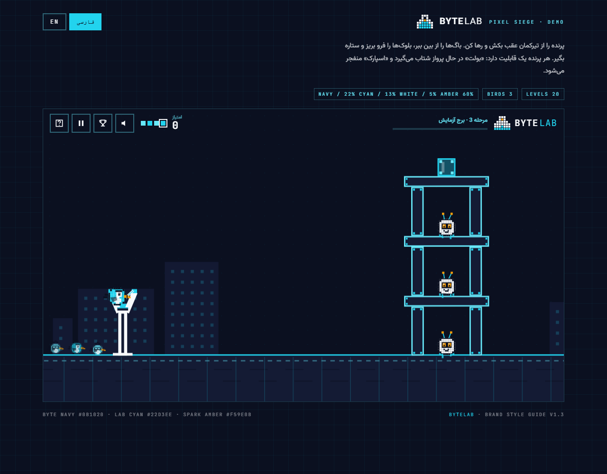
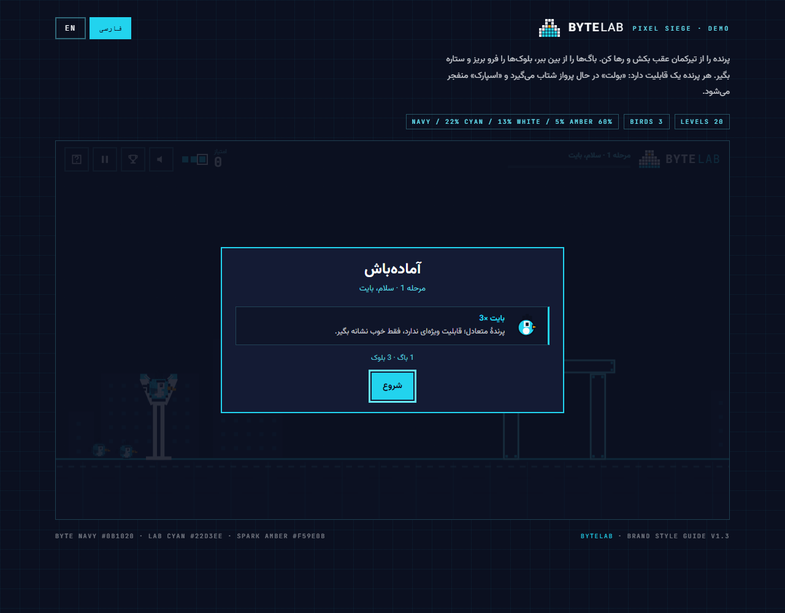
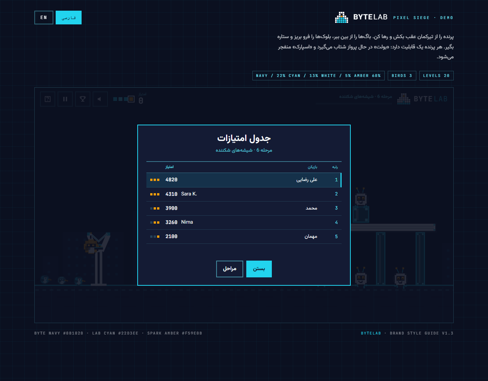
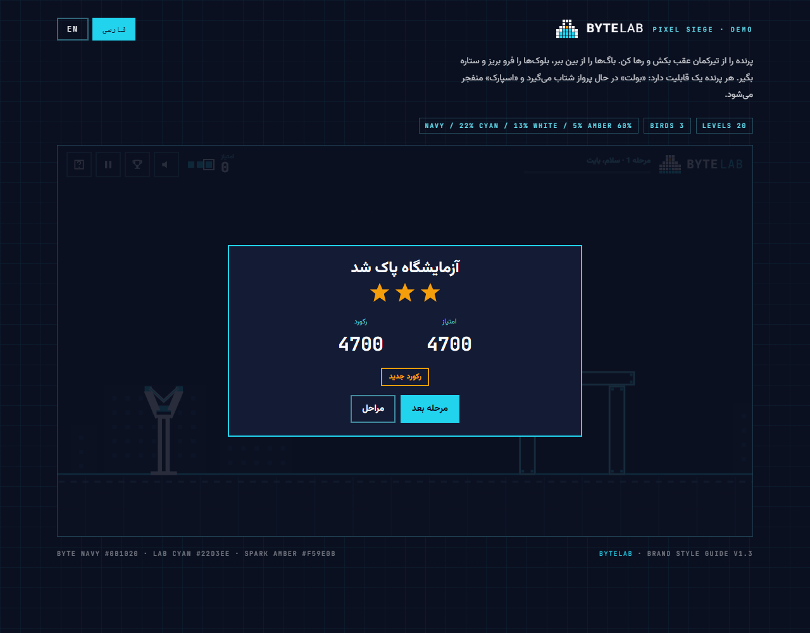
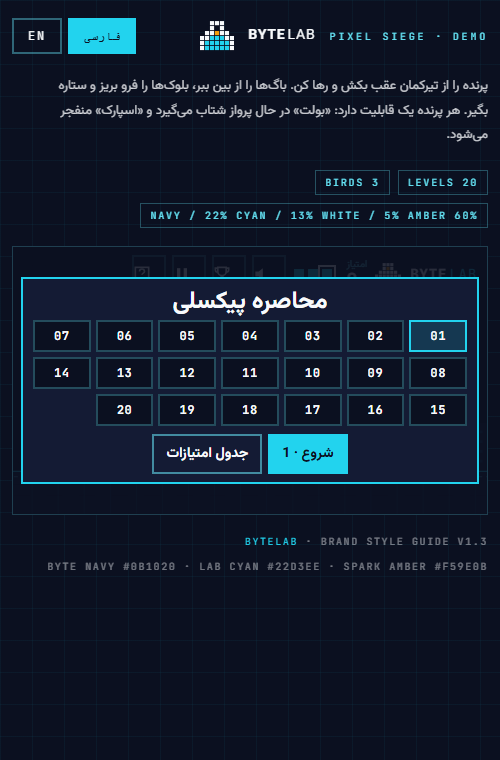

# BYTELAB · Pixel Siege

**A pull-and-fling physics game for WordPress, drawn entirely with the BYTELAB "Pixel Flask" brand system.**


[فارسی](README.fa.md) · [Play the demo](demo/bytelab-pixel-siege-demo.html) · [Screenshots](screenshots/)

---

Drag a pixel bird back on the slingshot, let go, and watch Panel Navy towers fold. Twenty levels, three bird types, a star rating, a leaderboard and a JSON level editor — all inside a single WordPress plugin that ships with its own fonts and has **zero runtime dependencies**.



## Features

| | |
| --- | --- |
| **Real physics** | Rotating rigid bodies, SAT collision, sequential impulses with warm starting, sleeping bodies, fixed 120 Hz step. Written for this plugin — no Box2D, no jQuery, no CDN. |
| **20 levels** | From a single hut to a full three-storey keep and a flask built from 23 blocks. Hand-tuned and verified playable by an automated solver. |
| **4 materials** | Panel, wall, glass and steel — each with its own mass, toughness and break behaviour. |
| **3 birds** | **BYTE** (balanced), **BOLT** (dash in flight), **SPARK** (explodes on tap). |
| **Briefing screen** | Every level opens with the birds you are given and what each one does. |
| **Bird queue** | The rest of your squad waits behind the sling and hops into the pouch after each shot. |
| **Leaderboard** | Top 10 per level over REST, with your own row highlighted. |
| **Custom levels** | Paste JSON in the settings screen; it is validated and clamped server-side. |
| **Brand fonts** | Vazirmatn + JetBrains Mono self-hosted (SIL OFL 1.1). No font CDN. |
| **Accessible** | Full keyboard control, `aria-live` status, `prefers-reduced-motion`, visible focus rings. |
| **Bilingual** | Persian (RTL) and English (LTR), picked from the WordPress locale. |

## Screenshots

| Briefing | Leaderboard |
| --- | --- |
|  |  |

| Level clear | Mobile |
| --- | --- |
|  |  |

## Requirements

- WordPress 6.0 or newer
- PHP 7.4 or newer
- A browser with Canvas 2D and Pointer Events (every current browser)

## Installation

**From the admin:** Plugins → Add New → Upload Plugin → choose `bytelab-pixel-siege.zip` → Install → Activate.

**From WP-CLI:**

```bash
wp plugin install bytelab-pixel-siege.zip --activate
```

**Manual:** copy the `bytelab-pixel-siege/` folder into `wp-content/plugins/` and activate it.

## Usage

Shortcode:

```
[bytelab_pixel_siege level="1" height="640"]
```

| Attribute | Default | Description |
| --- | --- | --- |
| `level` | `1` | Starting level (1–20, or a custom level number) |
| `height` | `640` | Maximum height in px; the game keeps a 16:9 ratio |
| `sound` | `1` | `0` starts muted |
| `title` | — | Optional heading |

Block: search for **Pixel Siege** in the inserter, or type `/pixel-siege`.

Settings live under **Settings → BYTELAB Pixel Siege**: starting level, height, sound, guest scores, leaderboard, briefing screen, copy overrides and custom levels.

## How to play

- Drag the bird back and release. A longer pull flies further; the dotted arc previews the shot.
- Tap (or press space) while the bird is flying to trigger its ability.
- Clear every bug to finish the level. Blocks in the way are fair game.
- **Keyboard:** arrows aim, `Space`/`Enter` fires, `P`/`Esc` pauses, `R` restarts.

| Bird | Colour | Ability |
| --- | --- | --- |
| BYTE | Lab Cyan | Balanced, no special move |
| BOLT | Liquid Cyan | Dash forward in flight |
| SPARK | Spark Amber | Explodes on tap, splash damage |

## Level editor

Paste an array of levels into **Settings → Custom levels (JSON)**:

```json
[
  {
    "name": { "fa": "آزمایش من", "en": "My Test" },
    "birds": ["byte", "spark", "bolt"],
    "blocks": [
      { "x": 900, "baseY": 570, "w": 30, "h": 120, "m": "panel" },
      { "x": 1000, "baseY": 570, "w": 30, "h": 120, "m": "panel" },
      { "x": 950, "baseY": 450, "w": 160, "h": 24, "m": "wall" }
    ],
    "bugs": [{ "x": 950, "surfaceY": 426, "r": 20 }]
  }
]
```

| Key | Meaning |
| --- | --- |
| `blocks[].x` | Horizontal centre (0–1280) |
| `blocks[].baseY` | Surface the block stands on, i.e. its bottom edge |
| `blocks[].y` | Alternative: vertical centre |
| `blocks[].w` / `h` | 8–400 |
| `blocks[].m` | `panel` · `wall` · `glass` · `deep` · `steel` |
| `bugs[].surfaceY` / `y` | Surface the bug sits on, or its centre |
| `bugs[].r` | 8–40 |
| `birds` | `byte` · `bolt` · `spark` |

The ground is at `y = 570`, so `"baseY": 570` puts a block on the floor. Limits: 40 levels, 90 blocks, 12 bugs and 10 birds per level. Invalid JSON is rejected and the previous levels are kept; out-of-range numbers are clamped, unknown materials and birds fall back to defaults.

## Leaderboard

`GET /wp-json/bytelab-pixel-siege/v1/leaderboard?level=3` returns the top ten for a level.

`POST /wp-json/bytelab-pixel-siege/v1/score` with `{ "level": 3, "score": 4820, "stars": 3 }` stores a run. The endpoint is rate limited (60 submissions per hour per visitor) and scores are written with prepared statements.

The board is optional and can be switched off in the settings; the game degrades to a clear message instead of an error.

## Brand system

The game is a literal implementation of the BYTELAB style guide v1.3.

| Token | Hex | Use |
| --- | --- | --- |
| Byte Navy | `#0B1020` | Primary surface |
| Panel Navy | `#141B34` | Blocks, panels |
| Lab Cyan | `#22D3EE` | Primary colour, links, accents |
| Liquid Cyan | `#67E8F9` | Highlights, outlines |
| Deep Cyan | `#0891B2` | Graphic accents |
| Spark Amber | `#F59E0B` | The single accent (SPARK, bug eyes) |
| Cloud White | `#F8FAFC` | Text, stone blocks |

The logo is the guide's **7 × 6 pixel flask** — three-block neck, seven-block base, eight liquid blocks and one amber bubble. No gradients, no shadows, sharp corners.

## Under the hood

```
bytelab-pixel-siege/            the plugin
├── bytelab-pixel-siege.php     bootstrap
├── includes/                   settings, assets, game, levels, scores
├── blocks/pixel-siege/         Gutenberg block (no build step)
└── assets/
    ├── fonts/                  Vazirmatn + JetBrains Mono (OFL)
    ├── js/physics.js           rigid-body engine
    ├── js/levels.js            20 levels + JSON normaliser
    ├── js/sim.js               rules, damage, scoring
    ├── js/render.js            canvas art
    ├── js/game.js              UI, input, sound, saves
    └── css/                    fonts.css, game.css, admin.css
demo/                           single-file offline demo
tools/                          tests and build scripts
```

The simulation runs at a fixed 120 Hz with a maximum of six catch-up steps per frame, so physics stays identical on 60 Hz and 144 Hz displays. Contacts are cached between steps and warm-started, which is what keeps a four-storey tower from creeping.

## Development

```bash
node tools/build-demo.js       # rebuild demo/bytelab-pixel-siege-demo.html
node tools/fetch-fonts.js      # re-download the OFL webfonts
node tools/test-levels.js      # geometry, 6 s stability and winnability of all levels
node tools/test-dom.js         # UI smoke test (shimmed DOM)
node tools/test-demo.js        # single-file demo integrity
php  tools/test-php-levels.php # JSON validator (25 assertions)
```

`tools/rasterize.py` turns recorded draw calls into PNGs, which is how the visual checks in this repository were produced without a browser.

## Customisation

```php
add_filter( 'bytelab_ps_game_config', function ( $config ) {
    $config['level'] = 7;
    $config['showIntro'] = false;
    return $config;
} );
```

Copy overrides can also be set from the settings screen as `key=value` lines (`title=Pixel Siege`).

## Credits

- **Vazirmatn** by Saber Rastikerdar — SIL OFL 1.1
- **JetBrains Mono** by JetBrains — SIL OFL 1.1

Both are bundled with their license texts in `assets/fonts/`.

## License

GPL-2.0-or-later. See [LICENSE](LICENSE).
